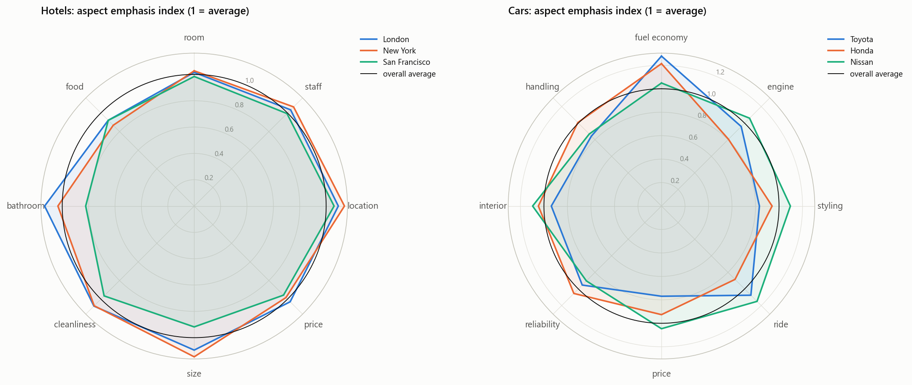
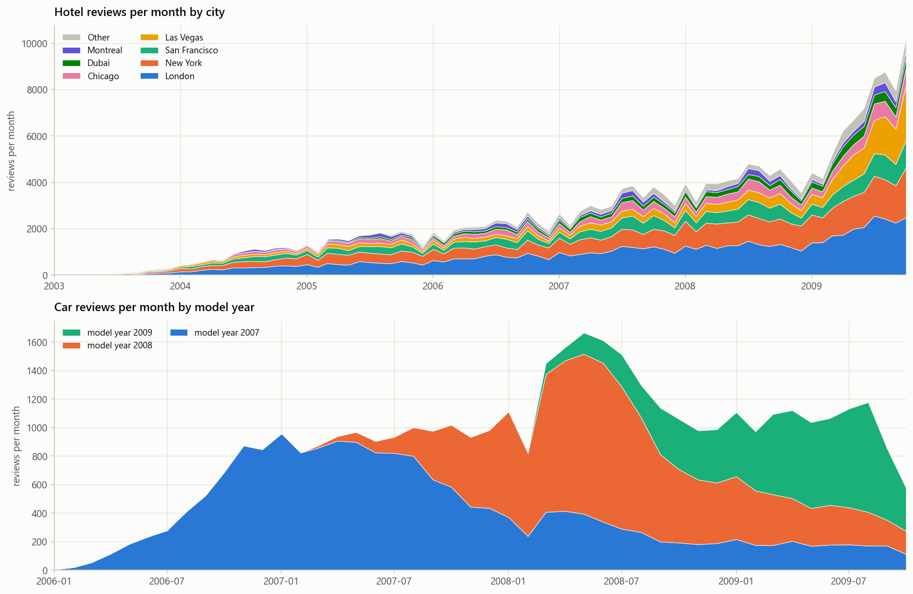
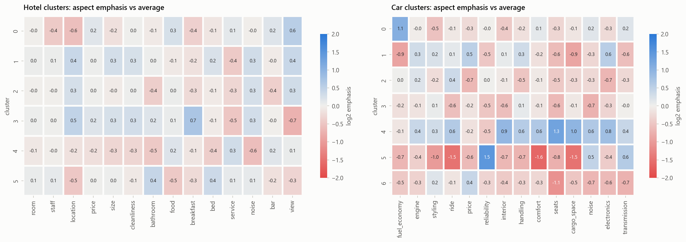
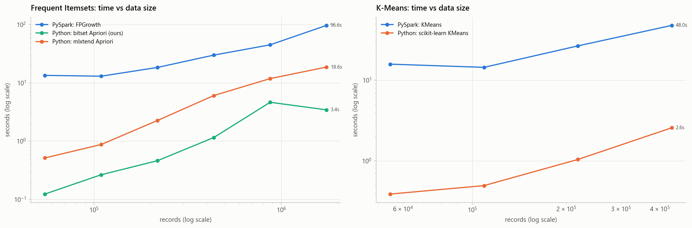

# OpinRank Review Mining

Opinion mining on **261,330 hotel and car reviews** from the [OpinRank Review Dataset](https://archive.ics.uci.edu/dataset/205/opinrank+review+dataset), end to end:

- data cleaning;
- 14 visualisations;
- **Apriori, A-Close and Apriori-based sequential-pattern mining implemented from scratch**;
- k-means clustering on LSA text vectors;
- a measured **PySpark vs single-machine Python** benchmark.

The dataset has no star ratings or labels, so every analytical attribute (aspects mentioned, sentence-level sentiment, length, time) is built from the raw text.

📄 **Full write-up:** [`report/ASBD_OpinRank_report.pdf`](report/ASBD_OpinRank_report.pdf) (33 pages)<br>
📓 **All code and outputs in one notebook:** [`src/ASBD_OpinRank_full.ipynb`](src/ASBD_OpinRank_full.ipynb)

## Key findings

- **Negative car reviews are about reliability and the dealer.** Three independent methods agree:
  - the rule {dealer, reliability} ⇒ negative has **lift 4.2**, and 56 % of negative car reviews discuss reliability;
  - the sequential pattern ⟨dealer⟩ → ⟨reliability⟩;
  - a k-means cluster of dealer/problem reviews that is **43 % negative**.
- **Negative hotel reviews mention the same aspects as positive ones.** No aspect combination predicts them (best lift 1.05); what differs is *how* aspects are described.
- **Reviews follow a narrative order.** Hotel reviews open with the room (30 %) or location (20 %), and *size* follows *room* in 85 % of reviews. Car reviews discuss the engine before fuel economy.
- **Unsupervised clusters are interpretable.** Hotels split into 4 city clusters (Las Vegas, New York, San Francisco, London), short praise (31 %) and long complaint narratives (23 %).
- **Closed itemsets:** at practical supports every frequent itemset is already closed (FI = CFI = 2,300), so the compression comes from maximal itemsets (2,300 → 356). At 0.1 % support, A-Close finds 95 exact rules, all predicting a positive review.
- **PySpark finds identical patterns but is 5–40× slower on one laptop** at this scale, with about 13 s of fixed overhead per job. Spark k-means gains 3× from 12 cores; Spark FP-Growth gets no parallel gain on one machine. Spark pays off once data outgrows a single machine.

| Aspect emphasis by city and make | Review volume over time |
|---|---|
|  |  |
| **What each k-means cluster talks about** | **PySpark vs Python run time** |
|  |  |

## What's inside

| Part | Notebook | Methods |
|---|---|---|
| 1. Cleaning | `01_load_clean` | regex parsing of two raw formats, UTF-8/cp1252 decoding, 10 cleaning steps (empty and duplicate reviews, noise smoothing, IQR outliers, language heuristic, date consistency, entity normalisation, equal-depth binning), aspect extraction, parallel VADER sentiment |
| 2. Descriptive analytics | `02_eda_plots` | attribute selection by cardinality and correlation, Pareto-based row and vocabulary selection, normalisation and discretisation, 14 plots: pie, doughnut, histogram, dot, stem-and-leaf, scatter, box, Pareto, radar, area, heatmap, bar, line, 100 % stacked bar |
| 3. Pattern mining | `03_arm` | Apriori with vertical TID-bitsets (cross-checked against mlxtend), lift/conviction rules, sentiment-targeted rules, GSP sequential patterns, A-Close (minimal generators → closures), closed (min-max) rules |
| 4. Clustering | `04_kmeans` | TF-IDF → TruncatedSVD (LSA) → unit vectors (cosine geometry), k-means with elbow (knee) and silhouette, if-then cluster descriptions, Ward dendrogram with K-cluster lifetimes |
| 5. Big data | `05_pyspark` | Spark MLlib FPGrowth and KMeans against mlxtend, our Apriori and scikit-learn on 55k–1.75M records, plus 1/4/12-core speed-up |

The algorithms in [`src/algos.py`](src/algos.py) are self-tested against textbook examples and on 30 random databases (`python algos.py`).

## Repository layout

```
src/
  01_load_clean.py … 05_pyspark.py   notebook sources (cells separated by "# %%")
  01_load_clean.ipynb … 05_pyspark.ipynb   executed notebooks with outputs
  ASBD_OpinRank_full.ipynb           all five parts merged into one notebook
  algos.py        Apriori, A-Close, GSP, rule generation (from scratch)
  textprep.py     parsers, text cleaning, aspect lexicons, sentiment
  vader_worker.py parallel sentiment worker
  plots.py        shared plot style and helpers
  nbtools.py      builds + executes notebooks from the .py sources
  build_full.py   merges the parts into one notebook
outputs/figs/     all figures (PNG)
outputs/tables/   all result tables (CSV): cleaning log, rules, clusters, benchmark
report/           the full report (PDF)
```

## Running it

1. **Requirements:** Python 3.11+, and Java 11 for PySpark. Then `pip install -r requirements.txt`.
2. **Data:** download the dataset from [UCI](https://archive.ics.uci.edu/dataset/205/opinrank+review+dataset) and extract the inner `OpinRankDataset.zip` so that `…/OpinRank/cars` and `…/OpinRank/hotels` exist.
   - Default locations: `RAW = C:\data\ASBD_exam\raw\OpinRank` for the raw data and `CLEAN = C:\data\ASBD_exam\clean` for the intermediate files. To use other locations, edit `RAW` / `CLEAN` at the top of the notebooks.
   - The archive contains a stray `.rar` file among the hotel files; the parser skips it.
3. **Run** from `src/`:
   ```bash
   python nbtools.py 01_load_clean.py 02_eda_plots.py 03_arm.py 04_kmeans.py 05_pyspark.py
   ```
   Each notebook is rebuilt from its `.py` source and executed. That takes about 30 minutes on a 12-thread laptop, most of it the Spark benchmark. NLTK's VADER lexicon (~100 KB) is downloaded on the first run. You can also open the `.ipynb` files directly, with `src/` as the working directory.

## Dataset and citation

The data is **not included** in this repository. Please download it from UCI and cite the authors:

> Kavita Ganesan and ChengXiang Zhai, "Opinion-Based Entity Ranking", *Information Retrieval*, 2011. doi:10.1007/s10791-011-9174-8

## License

The code is released under the [MIT License](LICENSE). The OpinRank dataset is subject to its own terms.
